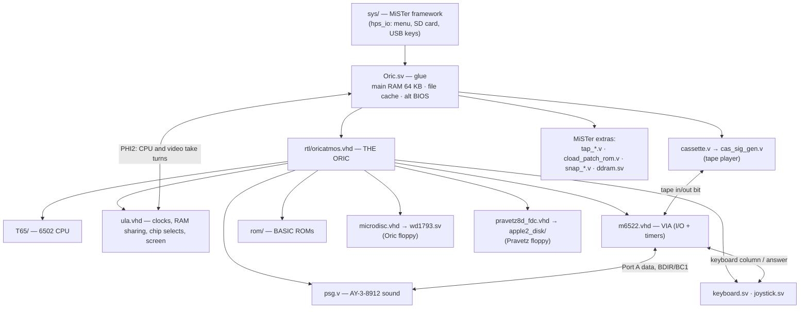

# MAP — find your way around the Oric core

Read this first. It tells you which files matter, how they connect, and where to look for each
part of the machine. The comments in `annotated/` tell you what the code inside does.

**What "★ SECTION n" means.** Each file in `annotated/` is cut into numbered parts. Each part
starts with a comment line like this:

```
// ★ SECTION 11 — THE ORIC ITSELF
// This one block IS the Oric computer: rtl/oricatmos.vhd. ...
```

So "`Oric.sv` ★ SECTION 11" means: open `annotated/Oric.sv`, search for `★ SECTION 11`, and read
the code below that comment, up to the next `★`. The numbers count only inside one file —
`Oric.sv` and `oricatmos.vhd` each have their own SECTION 1 to 19.

## The 4 layers

Each layer uses the one below it.

| Layer | File(s) | What it is | Open it? |
|---|---|---|---|
| 1 | `sys/` (≈52 files) | The MiSTer framework. The same in every MiSTer core. `sys/sys_top.v` is the real top of the build. | No — treat as a black box |
| 2 | `Oric.sv` | MiSTer glue: menu, file loading, RAM, video/sound out, fast tape, savestates | Yes — `annotated/Oric.sv` |
| 3 | `rtl/oricatmos.vhd` | **The Oric computer.** Connects CPU, ULA, VIA, sound, keyboard, ROMs, disk | Yes — `annotated/rtl/oricatmos.vhd` |
| 4 | `rtl/*` chip files | One file per chip (see the table below) | Yes, one at a time |

The build list is `core/files.qip`. If a file is not in it, it is not in the core.

## Diagram — who uses whom



## The files

### The Oric (study these)

| File | Real chip / job | Used by |
|---|---|---|
| `rtl/oricatmos.vhd` | The whole machine, wired together | `Oric.sv` ★ SECTION 11 |
| `rtl/T65/T65.vhd` (+ `T65_*.vhd`) | 6502 CPU | `oricatmos.vhd` ★ SECTION 7 |
| `rtl/ula.vhd` | ULA, the Oric's custom chip: 1 MHz clock, RAM sharing, address decode, **and the whole screen** | `oricatmos.vhd` ★ SECTION 10 |
| `rtl/m6522.vhd` | VIA 6522: keyboard scan, sound-chip control, tape, printer, timers, IRQ | `oricatmos.vhd` ★ SECTION 11 |
| `rtl/psg.v` | AY-3-8912 sound chip | `oricatmos.vhd` ★ SECTION 12 |
| `rtl/keyboard.sv` | Keyboard grid (PS/2 keys → Oric key matrix) | `oricatmos.vhd` ★ SECTION 13 |
| `rtl/joystick.sv` | USB gamepad → VIA Port A | `oricatmos.vhd` ★ SECTION 13 |
| `rtl/rom/*` | BASIC ROMs (5 of 13 files are built) | `oricatmos.vhd` ★ SECTION 9 — see `annotated/rtl/rom/README.md` |
| `rtl/spram.v` | General RAM block (main RAM, file cache, alt BIOS) | `Oric.sv` ★ SECTIONS 10, 14, 16 |
| `rtl/cassette.v` → `cas_sig_gen.v` | Plays a tape file as a tape signal | `Oric.sv` ★ SECTION 16 |

### Disk drives (optional)

| File | Job | Used by |
|---|---|---|
| `rtl/microdisc.vhd` | Oric Microdisc floppy interface | `oricatmos.vhd` ★ SECTION 15 |
| `rtl/wd1793.sv` | WD1793 floppy controller chip (4 copies, one per drive) | `microdisc.vhd` |
| `rtl/pravetz8d_fdc.vhd` | Pravetz-8D floppy (Apple II-style) | `oricatmos.vhd` ★ SECTION 14 |
| `rtl/apple2_disk/*` | Apple Disk II parts used by the Pravetz floppy | `pravetz8d_fdc.vhd` |

### MiSTer extras (not on a real Oric)

| File | Job | Used by |
|---|---|---|
| `rtl/tap_segment_loader.v`, `tap_byte_streamer.v`, `cload_patch_rom.v` | Fast tape loading | `Oric.sv` ★ SECTIONS 14, 17 |
| `rtl/tap_autorun_keys.v` | Types `CLOAD""` for you | `Oric.sv` ★ SECTION 8 |
| `rtl/snap_loader.v`, `snap_ss.v`, `savestate_hotkeys.v`, `ddram.sv` | Snapshots and savestates | `Oric.sv` ★ SECTION 18 |
| `rtl/pll.v`, `rtl/pll/` | Makes the clocks (Intel IP block) | `Oric.sv` ★ SECTION 4 |

### Ignore

| File | Why |
|---|---|
| `rtl/video.vhd` | **Dead code.** It is in `files.qip`, but nothing uses it. The ULA draws the screen itself. |
| 8 ROM files not in `files.qip` | Not built (list in `annotated/rtl/rom/README.md`) |
| `sys/*` except `hps_io.sv`, `video_mixer.sv`, `video_freak.sv`, `ltc2308.sv` | Framework plumbing |
| `releases/`, `img/`, `clean.bat`, `Oric.qpf`, `Oric.srf` | Build output and project files |

Other folders: `docs/` = maintainer notes (start at `docs/docs.md`; `docs/oric_memory_map.md` is
the best memory map). `tools/` = Python tools for tape and snapshot files. `dsk/`, `games/` =
sample software.

## Where to look for X

| I want to know… | Look in |
|---|---|
| How the Oric is wired together | `oricatmos.vhd` |
| How the CPU gets 1 MHz | `ula.vhd` (makes `ENA_1MHZ`), `oricatmos.vhd` ★ SECTION 7 |
| How CPU and screen share RAM | `ula.vhd` (`PHI2`), `oricatmos.vhd` ★ SECTION 8 |
| How the screen is drawn (text, HIRES, colour attributes) | `ula.vhd` |
| What the CPU reads at an address | `oricatmos.vhd` ★ SECTION 19 |
| How a key press reaches the CPU | `keyboard.sv` → `m6522.vhd` → `oricatmos.vhd` ★ SECTIONS 13, 16 |
| How sound is made | `psg.v`, controlled by the VIA (`oricatmos.vhd` ★ SECTION 12) |
| How tape loads | `cassette.v` (normal) or `tap_*.v` (fast), `Oric.sv` ★ SECTIONS 16–17 |
| How the menu works | `Oric.sv` ★ SECTIONS 2–3 |
| Where RAM is and how it is cleared | `Oric.sv` ★ SECTIONS 5, 10 |
| How savestates work | `Oric.sv` ★ SECTION 18 |

## Suggested reading order

1. This page.
2. `annotated/rtl/oricatmos.vhd` — section headers only, to see the parts.
3. `annotated/Oric.sv` — section headers only, to see what MiSTer adds.
4. Then one chip at a time, starting with `ula.vhd` (plan Phase 4).
